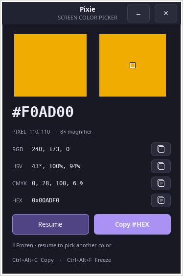

# Pixie for Ubuntu

A small native screen color picker for Ubuntu, inspired by [Nattyware Pixie](http://www.nattyware.com/pixie.php). Point at any pixel to see its color, magnify the area around it, and copy values into your editor or design tool.

Built with Python 3, GTK 3, and libX11. No Wine, pip packages, or network connection required at runtime.

> **X11 only.** Tested on Ubuntu 24.04. This version does not support screen capture on Wayland.

<p align="center">
  
</p>

## Features

- **Live sampling:** reads the pixel beneath your pointer 20 times per second.
- **8× magnifier:** highlights the selected pixel and handles screen edges.
- **Color formats:** HTML `#RRGGBB`, RGB, HSV, approximate CMYK, and Windows COLORREF hex.
- **Global shortcuts:** copy or freeze a color while another application has focus.
- **Always-on-top window:** keeps values visible as you work.
- **Easy copying:** moving into the picker preserves the last external color; each format has a copy button.
- **Local operation:** no telemetry, saved screen captures, network requests, or background service.

## Quick start

Install the system dependencies:

```bash
sudo apt update
sudo apt install git python3 python3-gi gir1.2-gtk-3.0 libx11-6 librsvg2-common
```

Clone and run:

```bash
git clone https://github.com/mdshajibazher/pixie-ubuntu.git
cd pixie-ubuntu
./run.sh
```

The launcher uses `/usr/bin/python3` so it can find Ubuntu's GTK bindings, even if a virtual environment is active.

### Check your desktop session

```bash
echo "$XDG_SESSION_TYPE"
```

The result should be `x11`. On Ubuntu 24.04, if it says `wayland`, log out, select your user on the login screen, choose **Ubuntu on Xorg** from the gear menu, and log in again. Pixie reports an unsupported-session message on Wayland instead of returning incomplete colors from XWayland windows.

## Install

Choose either a user installation or a system package.

### Install for your user

From the cloned project directory:

```bash
/usr/bin/python3 install.py
```

Search for **Pixie Color Picker** in Ubuntu's applications menu, or run:

```bash
~/.local/bin/pixie-picker
```

No `sudo` is needed. The installer copies the application to `~/.local/share/pixie-picker`, adds a launcher under `~/.local/bin`, and installs a desktop entry and icon. You can move or delete the source checkout after installation.

To update, close Pixie, run `git pull` in your checkout, rerun `install.py`, and reopen the app.

### Build and install a Debian package

Install the packaging tools if needed:

```bash
sudo apt install dpkg desktop-file-utils
/usr/bin/python3 build_deb.py
sudo apt install ./dist/pixie-picker_1.0.0_all.deb
```

The build runs without root and writes the package to `dist/`. Installation through `apt` resolves the declared runtime dependencies. Generated packages are not checked into Git.

## Usage and shortcuts

Launch Pixie and move your pointer over the color you want. The large value is the standard HTML hex code. Freeze a sample to keep it while moving elsewhere, or hover over the picker to use its copy buttons.

| Shortcut | Action | Scope |
| --- | --- | --- |
| `Ctrl+Alt+C` | Copy the current HTML color | Anywhere on the X11 desktop |
| `Ctrl+Alt+F` | Freeze or resume sampling | Anywhere on the X11 desktop |
| `Space` | Freeze or resume sampling | Pixie focused |
| `Ctrl+C` | Copy the current HTML color | Pixie focused |
| `Escape` | Close Pixie | Pixie focused |

Closing the window stops sampling and releases the global shortcuts. If another application owns a shortcut, Pixie identifies it as unavailable; the buttons still work.

### Understanding the values

| Format | Example | Meaning |
| --- | --- | --- |
| HTML / Copy #HEX | `#F0AD00` | Standard web order: red, green, blue |
| RGB | `240, 173, 0` | Three channels from 0 to 255 |
| HSV | `43°, 100%, 94%` | Hue, saturation, value |
| CMYK | `0, 28, 100, 6 %` | Approximate, unprofiled print-color conversion |
| HEX | `0x00ADF0` | Windows COLORREF order: `0xBBGGRR`, matching original Pixie |

Coordinates are physical pixels in the X11 root window. Values reflect screen RGB; the application does not perform ICC color-profile conversion. CMYK values are a mathematical approximation and should not be treated as a calibrated print specification.

## Troubleshooting

| Problem | What to check |
| --- | --- |
| Cannot connect to the desktop | Launch from a terminal in your graphical session, without `sudo`; an SSH or headless session may not have display access. |
| Wayland message | Use an X11 session; see the session instructions above. |
| `No module named gi` | Install `python3-gi` and use `./run.sh` or `/usr/bin/python3 launch.py`. |
| A global shortcut is unavailable | Another application may have reserved it. Use the copy/freeze buttons or release the conflicting binding. |
| Sampling appears stopped | Check whether **Resume** is shown, or whether your pointer is inside the picker. |
| Installed app has not updated | Close it, rerun the installer from the updated checkout, then reopen it. |

Multiple monitors sharing one X11 screen are supported by the capture implementation. Separate legacy X screens are not supported. Multi-monitor and HiDPI hardware combinations have not all been tested.

## Development and testing

Run the unit and startup checks:

```bash
/usr/bin/python3 -m unittest discover -s tests -v
```

Desktop tests are skipped by default. To run the complete suite, install the test tools and use the isolated desktop runner:

```bash
sudo apt install xserver-xephyr xinput libxtst6
/usr/bin/python3 tests/run_desktop_tests.py
```

The runner needs a working desktop connection. It opens a temporary nested X11 server, disables host input inside that server, and closes it afterward. It checks known-color capture, screen edges, freeze/resume, clipboard contents, global shortcuts, conflicts, and held-key repetition without altering your main desktop's clipboard or pointer.

The complete suite currently contains **9 tests**, including a fresh-process check for GTK 3/GTK 4 coexistence.

### Project layout

```text
pixie/
  app.py                 GTK window, previews, clipboard, and application lifecycle
  colors.py              HTML, RGB, HSV, CMYK, and COLORREF conversions
  x11.py                 libX11 capture and global shortcut handling
assets/                  Application icon
docs/images/             README screenshot
tests/                   Unit, startup, and desktop integration tests
run.sh                   Run directly from the checkout
launch.py                Installed application's entry point
install.py               User installation and desktop launcher
build_deb.py             Debian package builder
```

For bug reports, include your Ubuntu version, session type, display scaling, and steps to reproduce. Please avoid sharing screenshots containing private information.

## Uninstall

For a user installation, close Pixie and remove only its installed files:

```bash
rm -f ~/.local/bin/pixie-picker
rm -rf ~/.local/share/pixie-picker
rm -f ~/.local/share/applications/pixie-picker.desktop
rm -f ~/.local/share/icons/hicolor/scalable/apps/pixie-picker.svg
```

For a Debian package installation:

```bash
sudo apt remove pixie-picker
```

## Acknowledgments

Inspired by [Nattyware Pixie](http://www.nattyware.com/pixie.php). This is an independent implementation, not affiliated with Nattyware. No Windows executable, proprietary code, or original Pixie assets are included.
